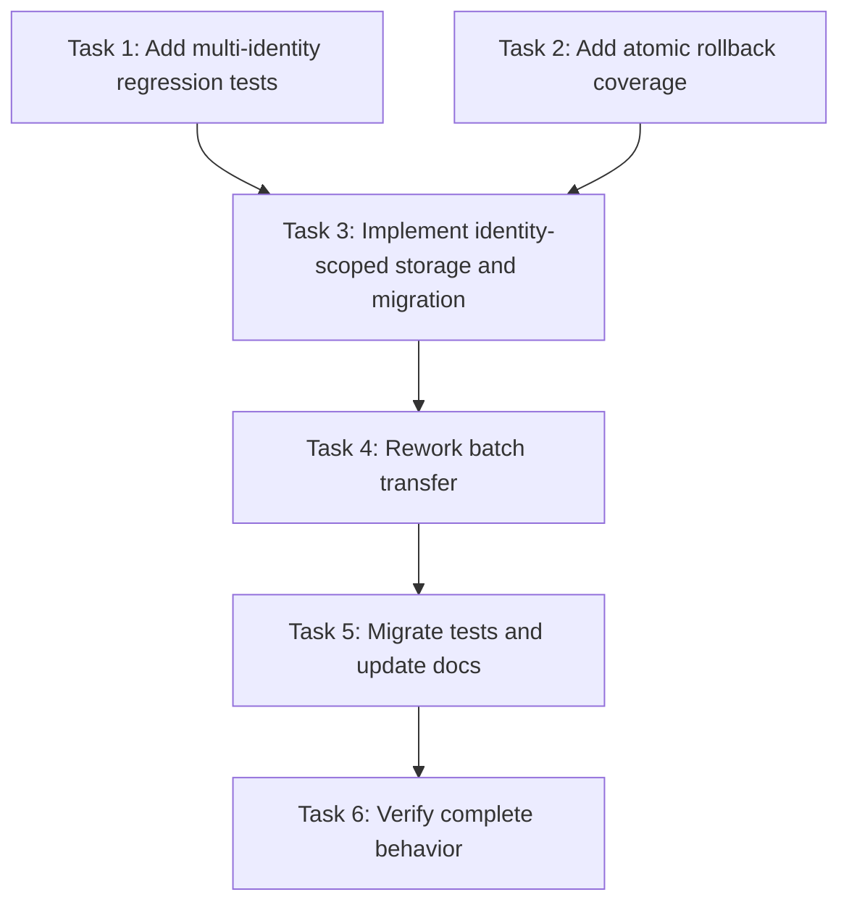

# Implementation Plan

Requirement references below point to the granular acceptance criteria in issue #1765 and its linked design documents:

- **R1 — Identity isolation:** each batch item reads and updates the bond belonging to its addressed identity; other identities remain unchanged. (#1765 Problem, Proposed Solution, Done When)
- **R2 — Atomicity:** any item failure rolls back the entire batch. (#1765 Proposed Solution, Done When; `docs/BATCH_ATOMICITY.md`, “Pattern A: all-or-nothing”)
- **R3 — Batch bound:** preserve `MAX_BATCH_BOND_SIZE` enforcement. (#1765 Proposed Solution)
- **R4 — Events:** preserve the existing batch event output and ordering. (#1765 Proposed Solution)
- **R5 — Storage compatibility:** use identity-scoped bond records and update storage fingerprinting and migration coverage for the layout change. (#1765 Technical Details; `docs/multi-identity-bonds.md`, “The Keying Scheme”)

- [ ] 1. Add regression tests for multi-identity batch transfers
  - Write focused cases in `contracts/credence_bond/src/test_batch_transfer.rs` and `test_batch.rs` showing that a batch updates each addressed identity's bond independently and leaves unaddressed identities unchanged.
  - Assert the existing event payload/order and rejection at the `MAX_BATCH_BOND_SIZE` boundary.
  - _Requirements: R1, R3, R4_

- [ ] 2. Add atomic rollback coverage for identity-scoped batches
  - Extend `contracts/credence_bond/tests/proptest_batch_atomicity.rs` or the existing focused batch tests with a batch whose later item fails after an earlier valid item.
  - Assert that no identity's bond state or related batch effects persist after the failure.
  - _Requirements: R1, R2_

- [ ] 3. Implement identity-scoped bond storage and migration
  - Update `contracts/credence_bond/src/storage.rs` and the relevant `DataKey` definitions in `src/lib.rs` so batch processing can load and save a bond using its identity address.
  - Update `src/migration.rs` to handle the previous single-bond storage layout without silently losing the existing bond.
  - Update `contracts/credence_bond/tests/datakey_fingerprint.rs` and migration tests to cover the new key layout and legacy-state behavior.
  - _Requirements: R1, R5_

- [ ] 4. Rework batch transfer to operate on each item's identity
  - Update `contracts/credence_bond/src/batch.rs` and any directly affected `src/lib.rs` entrypoint wiring to validate and apply each item against that identity's bond.
  - Preserve fail-fast atomic behavior, the existing batch-size limit, and event output; run the regression cases from Tasks 1–2.
  - _Requirements: R1, R2, R3, R4_

- [ ] 5. Migrate affected tests and document the resolved limitation
  - Update tests in `contracts/credence_bond/src/test_batch.rs` and `test_batch_transfer.rs` that assume one bond per contract instance, retaining coverage for single-identity behavior.
  - Update `docs/known-simplifications.md` to mark the batch-transfer limitation resolved and revise `docs/multi-identity-bonds.md` / `docs/BATCH_ATOMICITY.md` only where their documented behavior needs to match the implementation.
  - _Requirements: R1, R2, R3, R4, R5_

- [ ] 6. Verify the complete batch-transfer behavior
  - Run `cargo test -p credence_bond --locked` and fix regressions in the touched batch, migration, fingerprint, and proptest coverage.
  - _Requirements: R1, R2, R3, R4, R5_

## Tasks Dependency Diagram

